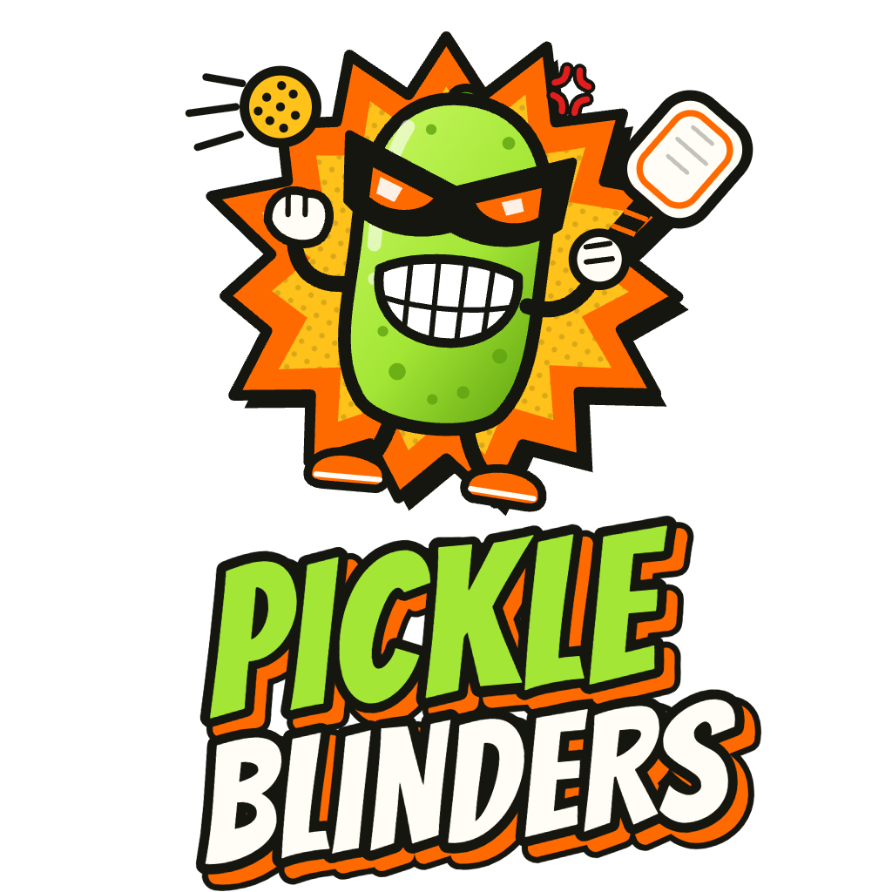

# Pickle Blinders

Fair player rotation and progress tracking for pickleball sessions. Works fully offline once opened.

Live: https://vordycam.github.io/pickle-blinders/

Pickle Blinders is a sibling of ThursDink. It has the same features (rotation, scoring, undo, levels, fixed partners, tournament mode, saved nights, PDF report, backup and restore, light/dark appearance) with its own name, look and saved data. A backup exported from ThursDink can be imported here from Stats, Export & Backup.

## Working on it

- No build step: open `index.html`, or serve the folder.
- Tests: `node test/engine.test.js`
- Bump `CACHE` in `sw.js` whenever `js/` or `styles.css` changes, or installed phones keep the old files.
- The look lives in the "Pickle Blinders skin" section at the end of `styles.css`; the rules above it are the shared layout.
- Artwork: `node tools/build-logo.js` writes `logo.svg` and two pages in `tools/out/`; `node tools/render-logo.js <node_modules with puppeteer-core>` turns those into `icons/*.png` and `logo-full.png`.

## Credits

The lettering is [Bangers](https://github.com/googlefonts/bangers) by Vernon Adams, under the SIL Open Font License (`fonts/OFL.txt`).
